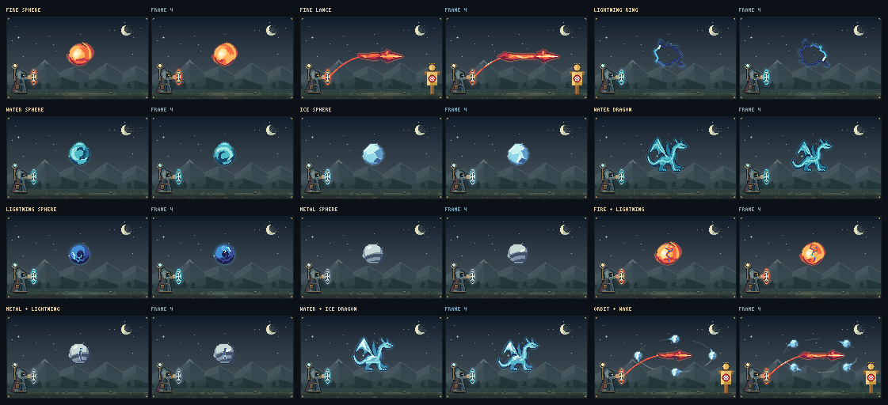

# Artes de magia: eletricidade e resposta dos materiais

Esta revisão parte de `ddf4e5d`, após os sprites autorais, as placas de gelo e as órbitas reais já integrados.

## Direção visual

- **Sea of Stars:** contraste entre sombras coloridas e pequenos destaques luminosos. [Referência oficial](https://seaofstarsgame.co/).
- **Dead Cells:** silhuetas legíveis, antecipação, descarga curta e recuperação. [Página oficial do jogo](https://store.steampowered.com/app/588650/Dead_Cells/).
- **Noita:** cada material reage de forma própria ao contato com outro. [Referência oficial](https://noitagame.com/press/).

A implementação é desenhada no renderizador do projeto, na resolução nativa de 180×105 pixels.

## Alterações

- A eletricidade passa de amarelo para índigo, azul e ciano. O fogo usa sombras vinho e planos coral; a luz mantém o ouro com sombras mais profundas. As rampas mantêm a quantidade anterior de tons e contraste crescente.
- A esfera elétrica recebe um sprite próprio com núcleo escuro, canais ramificados e frente de descarga em um ciclo de oito quadros.
- Fogo/Raio conduz um pulso ao longo da superfície; a chama responde um quadro depois e o canal esfria. A fusão conserva os planos da cor principal e aplica a cor secundária no contato, evitando a neutralização entre coral e ciano.
- Metal/Raio conduz o pulso no trilho, com reflexo somente junto da frente elétrica.

As runas e os círculos do editor, as regras da ficha, a interpretação das intenções, as quantidades e os controles de reprodução mantêm seu funcionamento. As placas de Água/Gelo e os detalhes do dragão continuam protegidos.

## Revisão reproduzível

```sh
npm ci
npm run typecheck
npm test
npm run build
node scripts/render-spell-gallery.mjs .spell-review
```

O script usa Vite em SSR e produz `spell-gallery.png` e `spell-gallery.gif` com 12 casos. O PNG mostra os quadros 0 e 4 lado a lado com as cores exatas. O GIF mostra os oito quadros do ciclo. A galeria verifica resolução, repetição do ciclo, movimento visível e ausência de alterações nos dados de entrada.

O workflow do pull request guarda essas imagens como artefato `spell-art-review`. A versão de código `e0d0c417` passou no [GitHub Actions](https://github.com/PietroPasqual/c-rculo-magico/actions/runs/39075676953):

- 2.686 testes aprovados em 54 arquivos.
- TypeScript e build de produção aprovados.
- Auditoria de dependências: zero vulnerabilidades.
- 12 casos renderizados, com ciclo repetível e movimento visível. Todos têm oito quadros distintos, exceto gelo, que conserva uma pose repetida de sua face rígida.



[Ver a galeria animada](visuals/electric-art/spell-gallery.gif).

A inspeção usa a saída nativa do renderizador. Não houve uma nova sessão interativa de navegador nesta revisão.
